 

 

## 👋 About me

I'm an **MCA graduate (2026)** who builds software that solves concrete problems rather than only demonstrating technologies. My work spans **backend APIs, AI-assisted decision systems, full-stack products, civic technology, real-time systems and data analytics**, from database and API design to the frontend, authentication, testing, deployment and documentation.

<table>
<tr>
<td width="50%" valign="top">
  
<strong>🎯 Focus</strong>

  <ul>
  <li>Backend &amp; full-stack product development</li>
  <li>AI-powered business workflows (RAG, OCR, agents)</li>
  <li>Secure API and application architecture</li>
  <li>Cloud deployment &amp; production engineering</li>
  </ul>
</td>
<td width="50%" valign="top">
  
<strong>⚡ At a glance</strong>

  <ul>
  <li>🎓 MCA, Nitte Meenakshi Institute of Technology</li>
  <li>💼 2 internships (backend &amp; web)</li>
  <li>📄 2 IEEE conference publications</li>
  <li>🏅 4 certifications (AI, Cloud, SAP, Oracle)</li>
  <li>🟢 Open to Software / AI Engineering roles</li>
  </ul>
</td>
</tr>
</table>

 

## 🧰 Tech stack

<table>
<tr>
<td width="170"><b>Languages</b></td>
<td> &nbsp;+ SQL</td>
</tr>
<tr>
<td><b>Backend & APIs</b></td>
<td> &nbsp;REST · JWT · OAuth · WebSockets</td>
</tr>
<tr>
<td><b>Frontend & Mobile</b></td>
<td> &nbsp;React Native · Expo</td>
</tr>
<tr>
<td><b>Databases</b></td>
<td></td>
</tr>
<tr>
<td><b>AI & Data</b></td>
<td> &nbsp;RAG · OCR · embeddings · ChromaDB</td>
</tr>
<tr>
<td><b>DevOps & Tools</b></td>
<td></td>
</tr>
</table>

 

## 🚀 Featured projects

<table>
<tr>
<td width="50%" valign="top">
  <h3>🏥 <a href="https://github.com/santhosh12133/medical-claim-ai">Medical Claim AI</a></h3>
  
<strong>AI-assisted medical reimbursement platform</strong>

  
OCR + policy RAG + deterministic validation + optional GPT assessment, with guarded decisions and human-review controls.

  
<code>Python</code> <code>FastAPI</code> <code>React</code> <code>PostgreSQL</code> <code>ChromaDB</code> <code>RAG</code> <code>OCR</code> <code>Docker</code>

</td>
<td width="50%" valign="top">
  <h3>🏙️ <a href="https://github.com/santhosh12133/CivicGuardAI">CivicGuardAI</a></h3>
  
<strong>Evidence-backed civic issue reporting</strong>

  
Citizen mobile app + admin portal + API with role-based workflows, EXIF/GPS validation, duplicate-image detection and an auditable issue lifecycle.

  
<code>React Native</code> <code>Expo</code> <code>Node.js</code> <code>PostgreSQL</code> <code>JWT</code>

</td>
</tr>
<tr>
<td width="50%" valign="top">
  <h3>🤖 <a href="https://github.com/santhosh12133/FNOL-Claims-Processing-Agent">FNOL Claims Processing Agent</a></h3>
  
<strong>Deterministic insurance claims triage</strong>

  
Extracts key fields from first-notice-of-loss documents, flags missing or inconsistent data and routes each claim with a plain-English explanation. CLI and Flask UI.

  
<code>Python</code> <code>Flask</code> <code>pdfplumber</code> <code>pytest</code>

</td>
<td width="50%" valign="top">
  <h3>📊 <a href="https://github.com/santhosh12133/Telco-Customer-Churn-Dashboard">Telco Customer Churn Dashboard</a></h3>
  
<strong>Churn analysis and predictive modeling</strong>

  
Preprocessing, SMOTE class balancing, Random Forest modeling, evaluation and an interactive Power BI dashboard.

  
<code>Python</code> <code>Pandas</code> <code>scikit-learn</code> <code>Power BI</code>

</td>
</tr>
<tr>
<td width="50%" valign="top">
  <h3>🔖 <a href="https://github.com/santhosh12133/smart-bookmark-app">Smart Bookmark App</a></h3>
  
<strong>Secure SaaS-style bookmark manager</strong>

  
Google OAuth, Supabase PostgreSQL with Row Level Security, search, filtering, analytics and production deployment on Vercel.

  
<code>Next.js</code> <code>TypeScript</code> <code>Supabase</code> <code>Tailwind CSS</code>

</td>
<td width="50%" valign="top">
  <h3>✅ <a href="https://github.com/santhosh12133/task-app">Task App</a></h3>
  
<strong>Full-stack AI-powered task management</strong>

  
Tasks, notes and dashboard analytics with JWT / Google sign-in, real-time sync, AI endpoints, validation and automated tests.

  
<code>React</code> <code>Node.js</code> <code>MongoDB</code> <code>Socket.IO</code> <code>JWT</code>

</td>
</tr>
<tr>
<td width="50%" valign="top">
  <h3>💬 <a href="https://github.com/santhosh12133/learnato-forum">Learnato Forum</a></h3>
  
<strong>Real-time learning discussion platform</strong>

  
Posts, replies, search, voting and answered-state workflows with live synchronization.

  
<code>React</code> <code>Vite</code> <code>Node.js</code> <code>MongoDB</code> <code>Socket.IO</code> <code>Docker</code>

</td>
<td width="50%" valign="top">
  <h3>🛒 <a href="https://github.com/santhosh12133/e-commerce">E-Commerce Platform</a></h3>
  
<strong>Customer and admin commerce system</strong>

  
Registration, authentication, product browsing, cart management and role-based product administration.

  
<code>PHP</code> <code>MySQL</code> <code>JavaScript</code>

</td>
</tr>
</table>

 

## 🔬 Research & certifications

<table>
<tr>
<td width="50%" valign="top">
  
<strong>📄 Publications</strong>

  <ul>
  <li><strong>DT-MR-FALCON:</strong> Digital Twin-Assisted Mixed Reality Emergency Corridor Optimization for Intelligent Ambulance Navigation, <em>IEEE ICECCC 2026</em></li>
  <li><strong>Automated Urban Issue Management Using YOLOv8 and Dynamic Team Dispatch Optimization</strong>, <em>IEEE ICISCN 2026 · IEEE Xplore</em></li>
  </ul>
</td>
<td width="50%" valign="top">
  
<strong>🏅 Certifications</strong>

  <ul>
  <li>Oracle Certified Foundations Associate: <em>Agentic AI</em></li>
  <li>SAP Certified: <em>SAP Generative AI Developer</em></li>
  <li>Microsoft Azure Fundamentals <em>(AZ-900)</em></li>
  <li>Artificial Intelligence: <em>Qualcomm</em></li>
  </ul>
</td>
</tr>
</table>

 

## 💼 Experience & education

| | Role | When |
|---|---|---|
| 💼 | **Software Developer Intern**, Truyon Technologies Backend services, secure REST APIs and relational schema design (Node.js, Express, SQL) | Jan – Mar 2026 |
| 💼 | **Junior Web Developer Intern**, Rats Technologies Python REST services, SQL data stores and query optimization | May – Jun 2024 |
| 🎓 | **MCA**, Nitte Meenakshi Institute of Technology, Bengaluru | 2024 – 2026 |
| 🎓 | **BCA**, Sri Bhagavan Mahaveer Jain College, KGF | 2022 – 2024 |

 

## 🧭 Engineering principles

> **Build for the real workflow, not just the demo.**
>
> Prefer deterministic rules where correctness matters · treat AI as a component, not an unquestioned authority · design authentication and authorization from the beginning · make failures observable and recoverable · document architecture and trade-offs · measure before making performance claims.

 

## 📫 Let's connect

I'm actively looking for **Software Engineering and AI Engineering** roles. If you're building something interesting, I'd like to hear about it.

- 🌐 **Portfolio:** [santhosh12133.github.io/Personal-portfolio](https://santhosh12133.github.io/Personal-portfolio/)
- 💼 **LinkedIn:** [santhosh-kumar-n](https://www.linkedin.com/in/santhosh-kumar-n-4b4b84310)
- 📧 **Email:** [santhoshkumar13012001@gmail.com](mailto:santhoshkumar13012001@gmail.com)
- 📄 **Resume:** [github.com/santhosh12133/my-resume](https://github.com/santhosh12133/my-resume)

 

